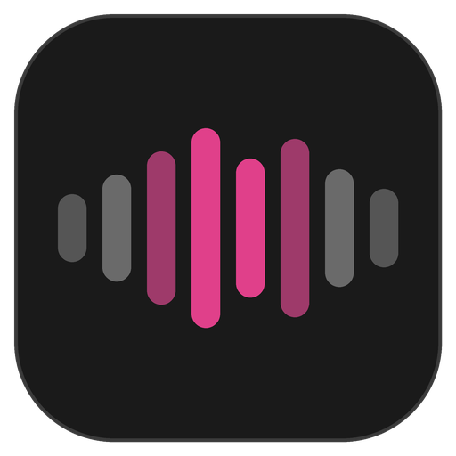
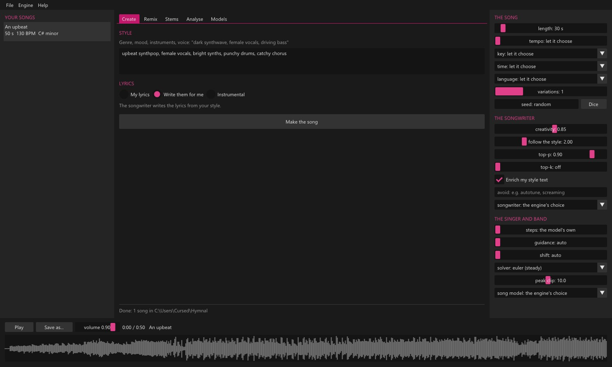

 

  

 

  
  
  
  

  
  
  

 

  

# Hymnal

**Whole songs, with vocals, made on your own PC.** Describe a style ("dark synthwave, female vocals, driving bass")
and Hymnal's songwriter writes the lyrics and the structure, then its singer and band perform it: verses, a chorus, a
real voice. Remix and cover songs, split them into stems (vocals, drums, bass, guitar...), and find a song's tempo and
key. No cloud, no account, no Python: [ACE-Step 1.5](https://github.com/ace-step/ACE-Step-1.5) running in C++ through
[acestep.cpp](https://github.com/ServeurpersoCom/acestep.cpp). Part of **[Atelier](https://github.com/CursedPrograms/Atelier)**,
Cursed Entertainment's creative suite. **[Website](https://cursedprograms.github.io/Hymnal/)**

## Features

- **Create:** a style in your own words, then your lyrics, lyrics it writes for you, or an instrumental. Length,
  tempo, key, time signature and the singing language (50+) are yours to set, or its to choose. Up to 4 variations
  at a time, each with its seed.
- **Every setting is a slider:** the songwriter's creativity, how closely it follows your style, top-p, top-k, what
  to avoid, and whether it enriches your style text; the song model's steps, guidance, shift, solver and loudness.
- **Remix:** drop in any song (WAV, MP3, FLAC, OGG...) and make a **cover** in another style, a **close cover**
  that keeps the original's shape, **repaint** a stretch of it (a new chorus, a better bridge), **complete** a song
  that stops short, or **add a track** to it.
- **Stems:** split a song into vocals, backing vocals, drums, bass, guitar, piano / keys, percussion, strings, synth,
  FX, brass and woodwinds, each as its own WAV.
- **Analyse:** the tempo (BPM) and key measured from the audio, its loudness, and ACE-Step listening to it and
  writing down its BPM, key, time signature, style and lyrics.
- **Your songs:** a list with the waveform, a player, Save As, and every song kept as a WAV in a Hymnal folder
  (Music\Hymnal, or Hymnal in your user folder when Windows guards Music).
- **Models:** the starter set in one click, every other model listed with its size and what it's for; downloads
  carry on where they stopped if the connection drops. Models live on a drive of your choice.
- **Any PC:** a CUDA engine for NVIDIA graphics cards (a 30-second song takes about 30 seconds on an RTX 2060) and
  a CPU engine for every other PC, picked for you.

## Download and run

Windows: download **Hymnal-win64.zip** from [Releases](https://github.com/CursedPrograms/Hymnal/releases), unzip it
anywhere and run `Hymnal.exe` (or `install.bat` for Start menu and Desktop shortcuts), or get it through the
[Atelier launcher](https://github.com/CursedPrograms/Atelier). The Visual C++ runtime is included.

The first time, open the **Models** tab and press **Get the starter set** (about 5 GB: the songwriter, the song model,
the text encoder and the audio decoder). Stems need the **Base** song model too (1.4 or 1.9 GB). Models go into
`F:\AIModels\music` when that drive exists, otherwise into Hymnal's settings folder; the Models tab can move them.

## Build

Windows: Visual Studio 2022 (C++), CMake, and [acestep.cpp](https://github.com/ServeurpersoCom/acestep.cpp) built twice:
`build-cuda` (with `-DGGML_CUDA=ON`, needs the CUDA 12 toolkit) and `build-cpu`. Then `build.bat` (or `build.ps1`) with
`ACESTEP` pointing at the acestep.cpp folder. It builds `build/Release/Hymnal.exe` and packs `dist/Hymnal-win64.zip`
with `engine\cuda` and `engine\cpu`. `install.bat` / `install.ps1` install it.

Linux: `./build.sh` (cmake, a C++17 compiler, libsdl2-dev), with ace-server beside it in `engine/cpu/`.

The code, in `src/`:
- `gui.cpp`: the window (SDL2, OpenGL 3, Dear ImGui): Create, Remix, Stems, Analyse, Models, the player
- `engine.cpp`: starts acestep.cpp's `ace-server` (the CUDA one when there's an NVIDIA card) and talks to it
- `http.cpp`: WinHTTP: the engine's API, and model downloads that carry on where they stopped
- `audio.cpp`: WAV reading and writing, other formats through FFmpeg when it's there, the waveform, tempo and key
- `catalog.h`: the models and what each is for
- `splash.cpp`: the splash shown while Hymnal starts, and in Help > About

## Credits

[ACE-Step 1.5](https://github.com/ace-step/ACE-Step-1.5) (ACE Studio and StepFun, Apache-2.0), run by
[acestep.cpp](https://github.com/ServeurpersoCom/acestep.cpp) (MIT) on [ggml](https://github.com/ggml-org/ggml) (MIT);
the GGUF models from [Serveurperso/ACE-Step-1.5-GGUF](https://huggingface.co/Serveurperso/ACE-Step-1.5-GGUF). Built
with [SDL2](https://www.libsdl.org) and [Dear ImGui](https://github.com/ocornut/imgui). See [NOTICE](NOTICE).

 

---
 

<a href="https://github.com/Farica-Kimora">Farica☆Kimora</a> © Cursed Entertainment 2026

 

 

  

